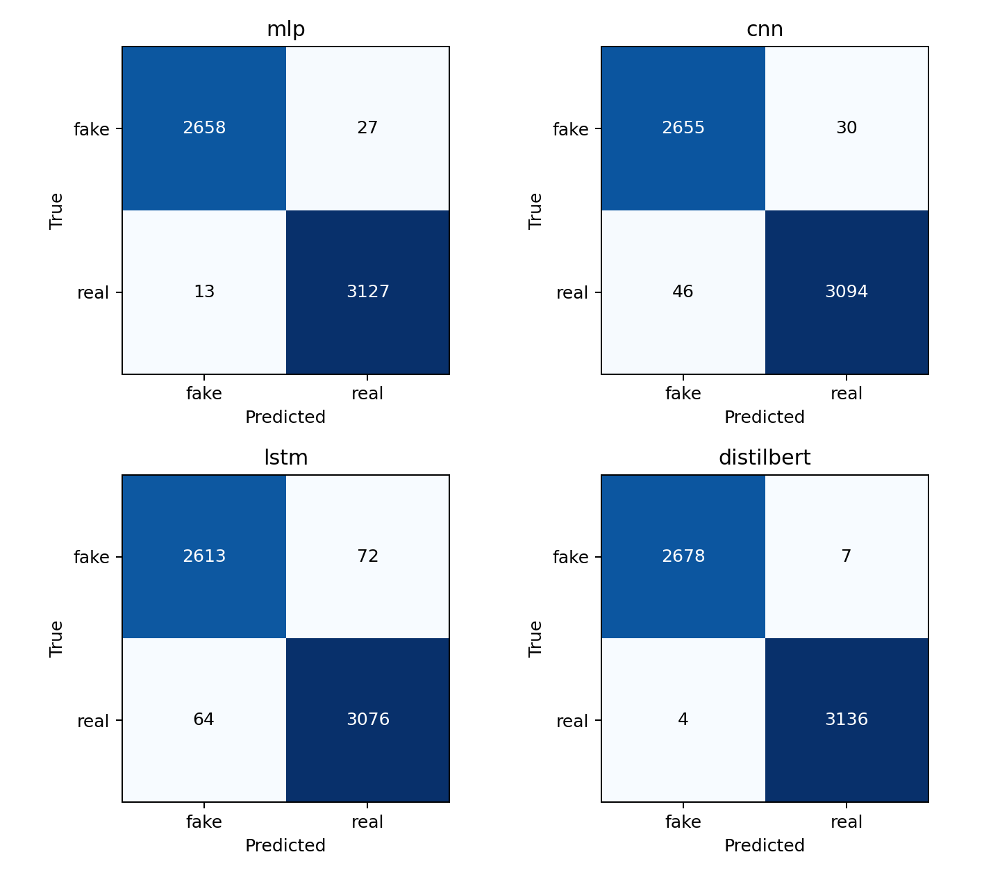
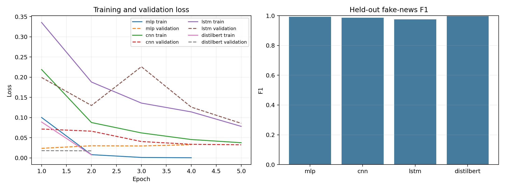

# Deep Learning Comparison for Fake News Detection

This project compares an MLP, CNN, LSTM, and fine-tuned DistilBERT on the ISOT Fake News Dataset. All models share the same cleaned, stratified 70/15/15 split and held-out test set. Predictions capture patterns in this dataset; they do not verify whether an article's claims are true.

## Project summary

This ICT-4442 project studies fake-news detection as binary classification of English article text. It compares a TF-IDF MLP, text CNN, LSTM, and fine-tuned DistilBERT using a shared preprocessing pipeline and held-out test protocol. The dataset is the ISOT Fake News Dataset, with Fake.csv and True.csv; articles are labeled fake (0) and real (1). The report discusses dataset-specific source and writing-style cues as a threat to generalization.

## Latest results

The reported Kaggle run evaluated 5,825 held-out articles (seed 42). DistilBERT achieved the highest accuracy and fake-class F1. MLP was the strongest compact baseline. The run used a shortened DistilBERT budget of two epochs, maximum sequence length 128, and batch size 32; the other models were configured for up to five epochs with early stopping.

| Model | Accuracy | Fake precision | Fake recall | Fake F1 |
|---|---:|---:|---:|---:|
| MLP | 99.31% | 99.51% | 98.99% | 99.25% |
| CNN | 98.70% | 98.30% | 98.88% | 98.59% |
| LSTM | 97.67% | 97.61% | 97.32% | 97.46% |
| DistilBERT | 99.81% | 99.85% | 99.74% | 99.80% |

Full metrics are available in [CSV](results/model_comparison.csv) and [JSON](results/model_comparison.json). This is one random split and one seed; it does not establish variation across runs or generalization to new publishers or periods.

### Confusion matrices



### Training and validation loss with held-out fake-class F1



## Project team

**Course:** ICT-4442, Deep Learning Project  
**Institution:** School of Computer Engineering, Manipal Institute of Technology, Manipal Academy of Higher Education

| Team member | Registration number | Model ownership |
|---|---:|---|
| Saish Hitesh Thakur | 230911512 | DistilBERT |
| Dilan Mathias | 220953015 | MLP |
| Adityanshu Sahu | 230953444 | LSTM |
| Eshan Bhandary | 230953004 | CNN |

## Requirements

Use Python 3.10 or newer. Install PyTorch for your CPU or CUDA environment, then install the remaining dependencies:

```powershell
python -m venv .venv
.\.venv\Scripts\Activate.ps1
python -m pip install --upgrade pip
pip install -r requirements.txt
```

## Get the dataset and prepare the split

Place the ISOT files `Fake.csv` and `True.csv` in `data/`. They are not committed to this repository; follow the dataset source's terms.

```powershell
python -m src.split_data --data-dir data --output-dir data/processed --seed 42
```

The pipeline removes blank and normalized duplicate articles, rejects duplicate text with conflicting labels, lowercases article text while preserving the structural `[SEP]` title/body delimiter, removes URLs and HTML, and strips common Reuters opening tags. Subject and date metadata are not model inputs. Labels are fake = 0 and real = 1. The split manifest contains article IDs, labels, and partition assignments without article text.

To reproduce a previously agreed assignment, pass its manifest:

```powershell
python -m src.split_data --data-dir data --output-dir data/processed --manifest path\to\split_manifest.csv
```

## Train models

Run each command from the repository root:

```powershell
python -m src.train_model --model mlp
python -m src.train_model --model cnn
python -m src.train_model --model lstm
python -m src.train_model --model distilbert
```

Defaults: MLP uses training-only TF-IDF unigrams and bigrams (up to 20,000 terms) with 256- and 64-unit hidden layers. CNN and LSTM use a training-only vocabulary capped at 30,000 tokens, 400-token sequences, and 128-dimensional embeddings. CNN has parallel 3-, 4-, and 5-token convolutions with 128 filters each. LSTM is unidirectional with 128 hidden units. DistilBERT defaults to `distilbert/distilbert-base-uncased`, maximum length 256, and three epochs. Neural models use Adam at learning rate 0.001, batch size 64, up to 20 epochs, dropout, and early stopping (patience 3). DistilBERT uses AdamW at learning rate 2e-5, batch size 16, weight decay 0.01, and linear warm-up/decay. Record changes to defaults when comparing runs.

Each training run saves its best validation checkpoint, configuration, split fingerprints, parameter count, and epoch history under `artifacts/<model>/`. The first DistilBERT run downloads pretrained model files and requires Internet access.

## Evaluate and compare

Evaluate each model once on the held-out test split, then create the CSV, JSON, and plots:

```powershell
python -m src.evaluate_model --model mlp
python -m src.evaluate_model --model cnn
python -m src.evaluate_model --model lstm
python -m src.evaluate_model --model distilbert
python -m src.compare_models --artifact-root artifacts --output-dir results
```

Metrics include accuracy, fake-class precision/recall/F1, confusion matrices, parameter count, mean training time per epoch, and inference time per 1,000 articles. Test errors are saved for human review; the code does not assign speculative error categories.

## Tests

The synthetic tests need neither the real dataset nor a downloaded Transformer:

```powershell
python -m unittest discover -s tests -v
```

GitHub Actions runs them on Python 3.10 and 3.12.

## License

This project is licensed under the MIT License; see [LICENSE](LICENSE). The dataset remains subject to its source terms.
